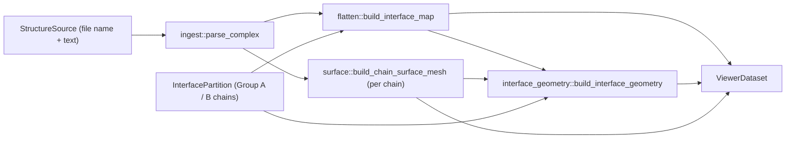

# Architecture

Two-crate Rust workspace. `smorgasprot-core` is the analysis engine: pure data in, pure data out, no UI dependencies. `smorgasprot-app` is the egui GUI for native desktop and (soon) WASM, plus the frozen HTML exporter. A bare `cargo run` launches the app (`default-members`).

```
smorgasprot/
├── design.md                 Vision and doc map
├── docs/                     This folder
├── examples/                 Bundled structures (7JVB.cif, fold_r8s15_mp3_model_0.cif)
├── viewer.html, js/          Legacy JS viewer (frozen; superseded by export/template.html)
└── crates/
    ├── smorgasprot-core/src/
    │   ├── model.rs              Index newtypes, ComplexStructure, ChainRecord, ResidueRecord, AtomRecord, SurfaceMesh
    │   ├── params.rs             AnalysisParams + param_group! macro (every tunable, with docs and ranges)
    │   ├── ingest.rs             PDB/mmCIF (optionally gzipped) from path or bytes → ComplexStructure
    │   ├── amino_acids.rs        Residue/element classification, vdW radii
    │   ├── dssp.rs               Secondary structure (file records, else DSSP)
    │   ├── spatial.rs            Uniform voxel hash grid
    │   ├── sasa.rs               Shrake-Rupley ΔSASA, interface inclusion
    │   ├── physics.rs            Clashes, H-bonds, salt bridges, aliphatic packing, interface graph
    │   ├── selection.rs          AtomSelection algebra (predicates, combinators, and ComplexStructure queries)
    │   ├── interface.rs          Submodule declarations and re-exports for interface cartography & geometry
    │   ├── interface/
    │   │   ├── definition.rs     InterfaceSide, InterfacePartition
    │   │   ├── model.rs          InterfaceMap, ProjectionPlane, ResidueTerritory, AtomNode, InterfaceEdge, InterfaceGeometry
    │   │   ├── flatten.rs        Projection plane (SVD), 2D relaxation → build_interface_map
    │   │   ├── contour.rs        Residue territory contours (SDF, Voronoi, Chaikin)
    │   │   └── geometry.rs       SDF sheet, contact envelope, sub-solvent voids + volume
    │   ├── surface.rs            Per-chain molecular surface (surface nets on a smooth-union SDF)
    │   └── rotamers.rs, minimize.rs  Phase 5 stubs
    └── smorgasprot-app/src/
        ├── main.rs               Native CLI: load, then GUI / --export-html / --serve
        ├── lib.rs                Module map and layering
        ├── app.rs                SmorgasprotApp: frame loop, panel layout, Action dispatch
        ├── camera.rs             Orbit camera, ViewAxis snapping
        ├── dataset.rs            ViewerDataset: render-ready snapshot (frozen JSON contract)
        ├── workspace.rs          Open structures: source text, groups, params snapshot, derived data
        ├── loader.rs             Load pipeline (parse → partition → map → meshes), built-in examples
        ├── jobs.rs               Background jobs (threads natively, inline on wasm)
        ├── files.rs              rfd dialogs, drag-and-drop, file-type detection
        ├── persistence.rs        config.rs (preferences), session.rs (session files)
        ├── state.rs              UiState, Action, StatusMessage; options, tween, view_params
        ├── style.rs              palette, lenses, sizing
        ├── panels.rs             top_bar, status_bar, complex/interface controls, inspector, parameters, widgets
        ├── viewport.rs           Input, picking, scene dispatch; complex_scene, interface_scene, gizmo, grid, draw_list, plane_space
        └── export.rs             html.rs + template.html (frozen viewer), server.rs (--serve)
```

Modules use the `foo.rs` + `foo/` layout (no `mod.rs`).

## Load pipeline



Every step takes its slice of `AnalysisParams`. Meshing dominates the cost, so loads and recomputes run as background jobs.

## Core data model (`model.rs`)

| Type | Role |
| --- | --- |
| `ComplexStructure` | All chains, residues, heavy atoms in file order. Group names and chain lists; `role: InterfaceSide` on residues and atoms. |
| `InterfaceSide` | `SideA`, `SideB`, `None` (unassigned chains: rendered slate, excluded from the map). |
| `InterfaceMap` | Pure topology plus cartography: `plane`, `territories`, `nodes` (`AtomNode`), `edges` (`InterfaceEdge`). Drives the Interface tab. |
| `InterfaceGeometry` | Derived visual meshes kept out of the map: `sheet_mesh`, `envelope_mesh`, `negative_mesh`, `void_volume_a3`. |
| `SurfaceMesh` | Vertices, normals, triangles, and `nearest_atom` per vertex (O(1) interface highlighting). |
| Index newtypes | `GlobalAtomIdx`, `GlobalResidueIdx`, `ChainIdx`, `AtomNodeIdx`, `TerritoryIdx` (dense `u32`). |

`AtomNode.b_factor` holds the crystallographic B-factor or AlphaFold pLDDT; the UI chooses the interpretation.

## App architecture

Dependency order, low to high: `camera`, `dataset` → `workspace`, `state` → `style` → `panels`, `viewport` → `app`. `loader`, `jobs`, `files`, `persistence`, `export` are I/O edges used by `app` and `main`. Lower layers never import higher ones.

Per frame, `SmorgasprotApp::update`:
1. Advances tweens, expires the status message.
2. Applies finished jobs (opened, recomputed, or session-restored structures).
3. Takes dropped files and starts load jobs.
4. Draws panels. Panels edit `UiState` directly and push `Action`s for app-level effects (open, save, export, recompute, select).
5. Draws the viewport. Only `viewport.rs` mutates camera and selection; scenes only paint.
6. Applies the queued actions.

Rendering is CPU-projected and painted as one depth-sorted `egui::Mesh` per frame (`DrawList`).

## Parameters

Every tunable number is a field in a `param_group!` struct: one declaration gives the value, default, unit (key suffix `_a`, `_a2`, `_deg`, `_px`), doc string, and editing range. A `ParamVisitor` lets the Parameters window render any group generically, so a new field shows up in the UI with no extra code.

- `AnalysisParams` (core): `sasa`, `contacts`, `relax`, `contour`, `surface`, `geometry`. Changing them requires a recompute.
- `ViewParams` (app, `state/view_params.rs`): `lenses`, `render`, `navigation`. Applied live.
- Layout chrome (gizmo geometry, panel widths) and physical constants (element radii) stay `const`.

Defaults reproduce the reference pipeline; the HTML export at defaults is a byte-identical regression check.

## Persistence

| Tier | Contents | Storage |
| --- | --- | --- |
| Preferences (`AppConfig`) | Working `AnalysisParams`, last `UiState` (incl. `ViewParams`), recent files | eframe storage (RON file natively, `localStorage` on web), auto-saved |
| Session (`Session`, `*.smorgasprot.json`) | Per structure: embedded file text, groups, `AnalysisParams` snapshot; plus `UiState` and active index | Explicit File → Save/Open Session |
| HTML report | `ViewerDataset[]` JSON in the frozen viewer template | File → Export |

All persisted structs use `#[serde(default)]`, so older files keep loading as fields are added. Sessions carry `format_version`; opening one recomputes each structure from its inputs, so results are reproducible across machines.

## Targets

- **Native**: `cargo run [-- FILE --group-a A --group-b C]`. File dialogs via `rfd` (xdg-portal on Linux).
- **HTML export**: `--export-html [out.html]` or File → Export. `ViewerDataset`'s JSON field names are a frozen contract with `template.html`.
- **Live server**: `--serve` hosts the HTML report and recomputes on chain reassignment (`POST /api/recompute`).
- **WASM** (planned): same `SmorgasprotApp`; jobs run inline, files arrive by drag-and-drop or the browser picker.
