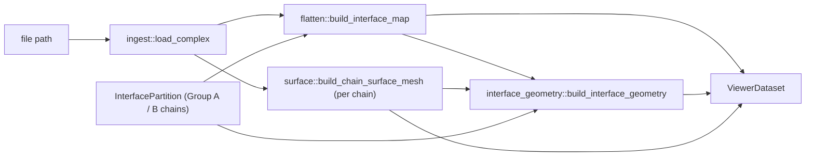

# Architecture

Two-crate Rust workspace. `smorgasprot-core` is the analysis engine: pure data in, pure data out, no UI dependencies. `smorgasprot-app` is the egui GUI for native desktop and (soon) WASM, plus the frozen HTML exporter. A bare `cargo run` launches the app (`default-members`).

```
smorgasprot/
├── design.md                 Vision and doc map
├── docs/                     This folder
├── examples/                 Bundled structures (7JVB.cif, fold_r8s15_mp3_model_0.cif, 8DCK.cif)
├── viewer.html, js/          Legacy JS viewer (frozen; superseded by export/template.html)
└── crates/
    ├── smorgasprot-core/src/
    │   ├── model.rs              Index newtypes, ComplexStructure, ChainRecord, ResidueRecord, AtomRecord, SurfaceMesh
    │   ├── params.rs             AnalysisParams + param_group! macro (every tunable, with docs and ranges)
    │   ├── ingest.rs             PDB/mmCIF from a file path → ComplexStructure (bytes/gzip ingestion is future work, needed once wasm drag-and-drop lands)
    │   ├── amino_acids.rs        Residue/element classification, vdW radii
    │   ├── dssp.rs               Secondary structure (file records, else DSSP)
    │   ├── spatial.rs            Uniform voxel hash grid
    │   ├── sasa.rs               Shrake-Rupley ΔSASA, interface inclusion
    │   ├── physics.rs            Clashes, H-bonds, salt bridges, aliphatic packing, interface graph
    │   ├── selection.rs          AtomSelection algebra (predicates, combinators, and ComplexStructure queries)
    │   ├── interface.rs          Submodule declarations and re-exports for interface cartography & geometry
    │   ├── interface/
    │   │   ├── definition.rs     InterfaceSide, InterfacePartition
    │   │   ├── model.rs          InterfaceMap, ProjectionPlane, ResidueTerritory, AtomNode, InterfaceEdge, InterfaceGeometry
    │   │   ├── flatten.rs        Projection plane (SVD), 2D relaxation → build_interface_map
    │   │   ├── contour.rs        Residue territory contours (SDF, Voronoi, Chaikin)
    │   │   └── geometry.rs       SDF sheet, contact envelope, sub-solvent voids + volume
    │   ├── surface.rs            Per-chain molecular surface (surface nets on a smooth-union SDF)
    │   └── rotamers.rs, minimize.rs  Phase 5 stubs
    └── smorgasprot-app/src/
        ├── main.rs               Native CLI: load, then GUI / --export-html / --serve
        ├── lib.rs                Module map and layering
        ├── app.rs                SmorgasprotApp: frame loop, panel layout, Action dispatch
        ├── camera.rs             Orbit camera, ViewAxis snapping
        ├── dataset.rs            ViewerDataset: the open structure (chains, interfaces, source complex, render-ready snapshot — frozen JSON contract)
        ├── render_policy.rs      Display defaults for a freshly loaded dataset (tessellation preset, face culling), as a pure function of atom count
        ├── loader.rs             Load pipeline (parse → partition → map → meshes), built-in examples
        ├── jobs.rs               Background jobs (threads natively, inline on wasm)
        ├── files.rs              rfd dialogs, drag-and-drop, file-type detection
        ├── persistence.rs        config.rs (preferences), session.rs (session files) — drafted, not yet wired into lib.rs
        ├── action.rs             Action: app-level commands queued by panels
        ├── status.rs             StatusMessage: status-bar notifications with expiry
        ├── state.rs              UiState; options, tween, view_params
        ├── style.rs              palette, lenses, sizing
        ├── panels.rs             top_bar, status_bar, complex/interface controls, inspector, widgets
        │                         (panels/parameters.rs is drafted but not yet wired into panels.rs)
        ├── viewport.rs           Input, picking, scene dispatch; complex_scene, interface_scene, gizmo, grid, draw_list, plane_space, gpu_surface
        └── export.rs             html.rs + template.html (frozen viewer), server.rs (--serve)
```

Modules use the `foo.rs` + `foo/` layout (no `mod.rs`).

There is deliberately **one** type for "a loaded structure": `dataset::ViewerDataset`. It
owns the source `ComplexStructure`, every computed `InterfaceViewData`, and the
analysis params that produced them. Editing chain-to-group membership goes through
`InterfacePartition` (via `ViewerDataset::add_interface`/`remove_interface`), not a separate
draft/commit pair.

## Load pipeline



`loader::load_path`/`loader::load` run this whole pipeline for one file; every step
takes its slice of `AnalysisParams`. Meshing dominates the cost, so loads run as
background jobs (`jobs::JobQueue`) rather than blocking the UI thread.

### Opening a structure after startup

File → Open Structure… (native file dialog, `files::dialogs::pick_structures`) or
dropping a `.pdb`/`.cif` file onto the window (`files::take_dropped`) both resolve to a
list of paths and call `SmorgasprotApp::start_load`, which spawns one background job
running `loader::load_paths` and timing it. On success the job's `JobOutput::Opened`
**replaces the whole workspace** — `self.datasets`/`self.active` and the selection are
reset to just the newly loaded structure(s) — and a success status message reports how
long the load took. A failed load leaves the current workspace untouched and shows an
error message instead. While a job is in flight, the status bar shows a spinner with
the job's label instead of the usual message/dataset summary. Startup (`main.rs`) does
not go through this path; it still loads the CLI file or bundled examples synchronously
before the window opens.

## Core data model (`model.rs`)

| Type | Role |
| --- | --- |
| `ComplexStructure` | All chains, residues, heavy atoms in file order. Group names and chain lists; `role: InterfaceSide` on residues and atoms. |
| `InterfaceSide` | `SideA`, `SideB`, `None` (unassigned chains: rendered slate, excluded from the map). |
| `InterfaceMap` | Pure topology plus cartography: `plane`, `territories`, `nodes` (`AtomNode`), `edges` (`InterfaceEdge`). Drives the Interface tab. |
| `InterfaceGeometry` | Derived visual meshes kept out of the map: `sheet_mesh`, `envelope_mesh`, `negative_mesh`, `void_volume_a3`. |
| `SurfaceMesh` | Vertices, normals, triangles, and `nearest_atom` per vertex (O(1) interface highlighting). |
| Index newtypes | `GlobalAtomIdx`, `GlobalResidueIdx`, `ChainIdx`, `AtomNodeIdx`, `TerritoryIdx` (dense `u32`). |

`AtomNode.b_factor` holds the crystallographic B-factor or AlphaFold pLDDT; the UI chooses the interpretation.

## App architecture

Dependency order, low to high: `camera`, `state` → `render_policy` → `dataset` → `style` → `panels`, `viewport` → `app`. `loader`, `jobs`, `files`, `persistence` (drafted, unwired), `export` are I/O edges used by `app` and `main`. Lower layers never import higher ones. (`render_policy` only borrows `state::SurfaceCulling`'s enum definition, not `UiState` itself — it's a pure function of a dataset's atom count, not app/UI logic. The only caller is `dataset::ViewerDataset::new`, which uses it to initialize `draw_preset`/`draw_mesh`/`culling` — all three live on `ViewerDataset` itself, editable afterward via the Complex panel, exactly like any other per-dataset fact; `app.rs` never touches render policy or these fields at all, by design — see `panels/complex_controls.rs` for where they're read/written instead.)

Per frame, `SmorgasprotApp::update`:
1. Advances tweens, expires the status message.
2. Applies any finished load job, replacing the workspace on success (see above).
3. Takes dropped files and starts a load job for any structure files among them.
4. Draws panels. Panels edit `UiState` directly and push `Action`s for app-level effects (open, export, select, dismiss status).
5. Draws the viewport. Only `viewport.rs` mutates camera and selection; scenes only paint.
6. Applies the queued actions.

Cartoon ribbons, atom spheres, and interface boundary/envelope/negative meshes are CPU-projected
and painted as one depth-sorted `egui::Mesh` per frame (`DrawList`). Chain molecular surfaces
instead render on a dedicated `wgpu` pipeline (`viewport/gpu_surface.rs`) with a real,
per-dataset depth buffer: a chain at effectively opaque alpha (`>= 0.999`) uses a normal
depth-tested, depth-writing pipeline (so triangle submission order never matters — this is what
guarantees alpha-1 chains actually occlude each other and themselves); a translucent chain
depth-*tests* but doesn't depth-*write*, so it's still correctly hidden behind nearer opaque
geometry without fighting other translucent fragments for the z-buffer, at the cost of blending
overlapping translucent layers in draw order rather than true back-to-front order (an earlier
attempt used Weighted Blended OIT instead; reverted; see the module's header comment for why it
can't guarantee opacity). The result is composited as one textured quad under the `DrawList`
layer; `complex_scene` falls back to the CPU triangle path for surfaces when no wgpu backend is
available. The two don't yet depth-test against each other (the GPU quad is always painted
first), and moving every Complex-tab primitive onto that same GPU target is tracked as future
work (`docs/roadmap.md`, Phase 4.1 item 9).

## Parameters

Every tunable number is a field in a `param_group!` struct: one declaration gives the value, default, unit (key suffix `_a`, `_a2`, `_deg`, `_px`), doc string, and editing range. A `ParamVisitor` lets the Parameters window render any group generically, so a new field shows up in the UI with no extra code.

- `AnalysisParams` (core): `sasa`, `contacts`, `relax`, `contour`, `surface`, `geometry`. Changing them requires a recompute.
- `ViewParams` (app, `state/view_params.rs`): `lenses`, `render`, `navigation`. Applied live.
- Layout chrome (gizmo geometry, panel widths) and physical constants (element radii) stay `const`.

Defaults reproduce the reference pipeline; the HTML export at defaults is a byte-identical regression check.

## Persistence

**Not yet wired in** — `persistence.rs` and `panels/parameters.rs` are drafted for this
but aren't declared in `lib.rs`/`panels.rs`, so none of the below exists in the running
app today (there's no Open Recent, no Save/Open Session, and no Parameters window with
a Recompute button). The design is kept here as the target for that follow-up milestone.

| Tier | Contents | Storage |
| --- | --- | --- |
| Preferences (`AppConfig`) | Working `AnalysisParams`, last `UiState` (incl. `ViewParams`), recent files | eframe storage (RON file natively, `localStorage` on web), auto-saved |
| Session (`Session`, `*.smorgasprot.json`) | Per structure: embedded file text, groups, `AnalysisParams` snapshot; plus `UiState` and active index | Explicit File → Save/Open Session |
| HTML report | `ViewerDataset[]` JSON in the frozen viewer template | File → Export |

All persisted structs use `#[serde(default)]`, so older files keep loading as fields are added. Sessions carry `format_version`; opening one recomputes each structure from its inputs, so results are reproducible across machines.

## Targets

- **Native**: `cargo run [-- FILE --group-a A --group-b C]`. File dialogs via `rfd` (xdg-portal on Linux).
- **HTML export**: `--export-html [out.html]` or File → Export. `ViewerDataset`'s JSON field names are a frozen contract with `template.html`.
- **Live server**: `--serve` hosts the HTML report and recomputes on chain reassignment (`POST /api/recompute`).
- **WASM** (planned): same `SmorgasprotApp`; jobs run inline, files arrive by drag-and-drop or the browser picker.
